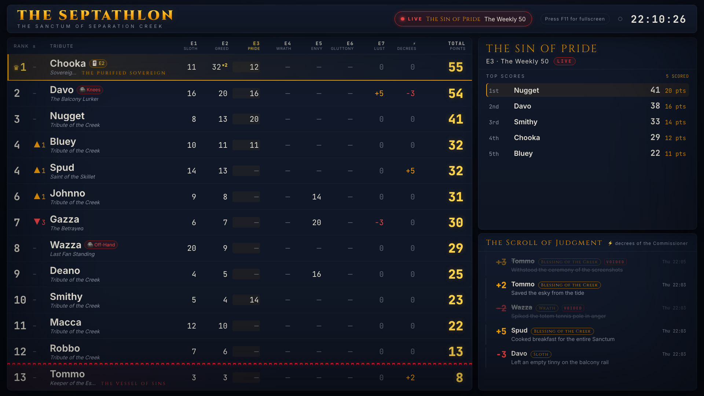

# CreekOS: The SEPtathlon

Live tournament tracker for the Sanctum of Separation Creek: an always-on TV
broadcast at `/tv`, a PIN-gated commissioner portal at `/admin`, and a scoring
engine where every number can be amended after the fact. One Next.js service,
one Postgres database, zero data loss when a phone dies or the beach Wi-Fi
drops.



## Run it locally

```bash
npm install
npm run dev        # http://localhost:8765
```

No database setup needed: without `DATABASE_URL` the app runs an embedded
Postgres (PGlite) at `./data/`. Open http://localhost:8765/tv for the board and
http://localhost:8765/admin (PIN `2026`) for the portal. `npm run seed:demo`
fills an empty database with a 13-tribute Saturday so you can poke around.

## Deploy to Railway (the PRD 5-minute checklist)

1. Railway → New Project → Provision **PostgreSQL**.
2. Add a service from this repo (or `railway up`). `railway.json` pins the
   Dockerfile build, a `/api/healthz` check, and one replica.
3. On the web service set two variables:
   - `DATABASE_URL` = `${{Postgres.DATABASE_URL}}` (reference variable)
   - `ADMIN_PIN` = your PIN (defaults to `2026`)
4. Deploy. The app migrates and seeds the seven events on boot. Production
   refuses to start without `DATABASE_URL` so a misconfigured deploy fails
   loudly instead of silently losing scores. (`CREEKOS_ALLOW_PGLITE=1`
   overrides that for local production-mode testing only.)

Point the TV at `https://<your-app>.up.railway.app/tv`, press F11, and keep the
commissioner phone on `/admin`. The TV polls every 2.5 s and holds the last
good board through dropouts, with a SIGNAL LOST badge until it reconnects.

## The seven events

| # | Event | Sin | Scoring |
|---|-------|-----|---------|
| 1 | Stubby Fan | Sloth | Elimination (3 lives) |
| 2 | Krillion | Greed | Highest raw score |
| 3 | The Weekly 50 | Pride | Highest raw score |
| 4 | Rock Hurl | Wrath | Elimination + curse levels |
| 5 | 50/50 Fruit Split | Envy | Lowest % off a perfect split |
| 6 | Grape Bobbing | Gluttony | Highest raw score |
| 7 | Dance on the Creek | Lust | Duos dance, scored 0–10; both members bank the score |

Placings pay 20, 16, 14, 12, 11, 10, 9, 8, 7, 6, 5, 4, 3, 2, 1. Ties split the
covered ranks and round up to the half point, so a two-way tie for 3rd pays 13
each. Each tribute holds one Mortal Sin Joker that doubles a single event
(1 through 6). Manual rank and points overrides in god-mode beat everything.

### Dance on the Creek

Event 7 is a dance-off. The commissioner draws random duos from the active
tributes (an odd count makes one trio), each duo dances, and the commissioner
types one score out of 10 (decimals allowed). Both members bank that score in
the Dance column. Scores can be amended or cleared at any time; redrawing wipes
the current duos and their scores, and a manual builder covers late arrivals.

## Commissioner quick reference

- **Decrees** (⚡ tab): pick tributes, pick points, pick a sin, write the
  reason, cast. Every decree can be edited or voided later; voided ones stay in
  the ledger struck through.
- **Events** (🏆 tab): guided mode runs the event live (lives, eliminations,
  score entry with rank preview, weigh-ins, duo draws and dance scores).
  Placements mode drags tributes into finishing order on the phone, with ties,
  and saves the result as rank overrides. God-mode is the
  spreadsheet view for recounts: change any raw value, override any rank or
  points, save, and the whole weekend recalculates.
- Typed score entry updates the board quietly; eliminations, dance scores, decrees,
  and setting an event LIVE or COMPLETED flash banners on the TV.
- **Roster** (👥 tab): late arrivals and dropouts are fine at any player count.
  Benched tributes keep their history and leave the board.
- **System** (💾 tab): remote-switch the TV view, export a full JSON backup,
  restore one (type RESTORE to confirm), and browse automatic snapshots (taken
  at most every 10 minutes, newest 48 kept, plus one before every restore).

## API

All mutating endpoints need the admin cookie (from `POST /api/login`) or an
`x-admin-pin` header. Mutators return the fresh full state. Errors are
`{"error": "..."}` with 400/401/404/409.

| Method | Endpoint | Purpose |
|--------|----------|---------|
| GET | `/api/state` | Full tournament state (ETag + 304; polled by the TV) |
| GET | `/api/healthz` | Railway healthcheck |
| POST | `/api/login` · `/api/logout` | Cookie auth |
| POST | `/api/players` | Create or update a tribute |
| POST | `/api/events/:id/score` | Upsert raw inputs, lives, eliminations, overrides |
| POST | `/api/events/:id/preview` | Rank preview without writing |
| POST | `/api/events/:id/status` | UPCOMING / LIVE / COMPLETED |
| POST | `/api/events/:id/joker` | Place or clear the 2× joker (409 on conflict, `force` moves it) |
| GET/POST | `/api/decrees` · PATCH `/api/decrees/:id` | The Dumbledore ledger |
| GET/POST | `/api/blood/matchups` · PATCH/DELETE `/api/blood/matchups/:id` | Dance duos: forge, score 0–10 (`{score}`; `{score: null}` clears), delete |
| POST | `/api/blood/generate` | Random duos for every active tribute (odd count makes one trio); wipes existing duos |
| POST | `/api/tv-mode` | LEADERBOARD / LIVE_EVENT / BLOOD_STAGE (the Dance stage) |
| GET | `/api/export` · POST `/api/restore` | Timestamped JSON backup and restore |
| GET/POST | `/api/snapshots` (+ `/:id`, `/:id/restore`) | Snapshot history |

## Development

```bash
npm test             # engine + repo suites (in-memory Postgres)
npm run typecheck
npm run e2e          # full tournament sim against a running server
node scripts/screenshots.cjs   # headless captures into docs/screenshots
npm run db:generate  # regenerate drizzle/ after schema changes
```

Stack: Next.js 15 App Router, strict TypeScript with
[`@total-typescript/ts-reset`](https://github.com/mattpocock/ts-reset), Zod v4
on every input, Drizzle ORM, postgres-js in production and PGlite locally,
Motion for the TV animations. Product spec lives in `docs/PRD.md`; the
decisions the PRD left open are in
`docs/superpowers/specs/2026-11-11-creekos-design.md`.

A word of warning from the Creek: the admin PIN is party-grade auth, not bank
auth. Keep the URL inside the house group chat.
